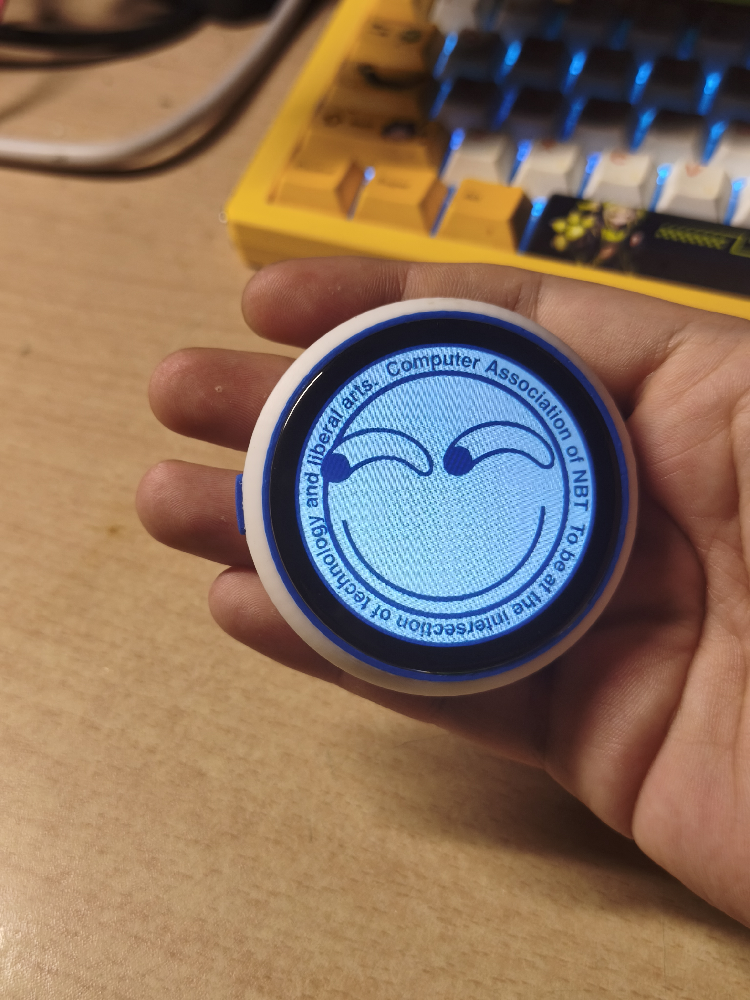
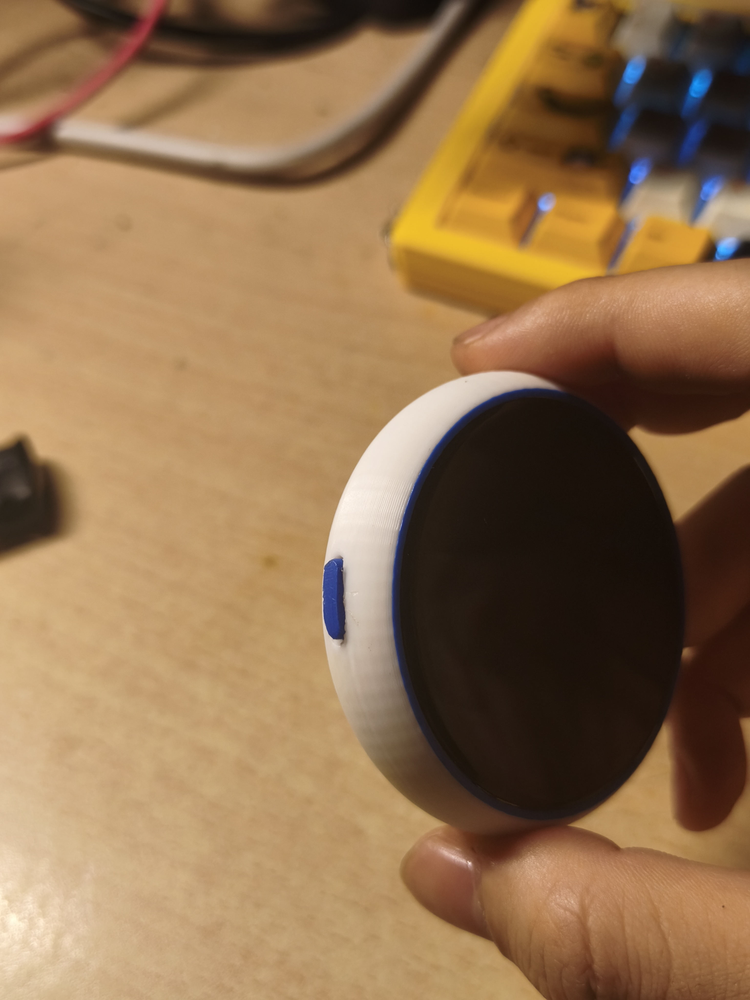
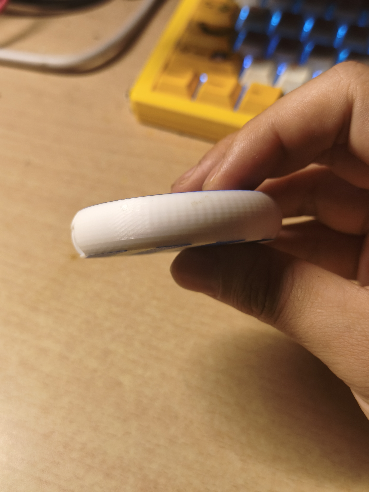

# CABadge · 计协电子吧唧

基于 ESP32-S3 的开源圆屏电子徽章，面向日常佩戴与社团展示。用静态或动态壁纸表达个人喜好，通过触摸切换协会名片和小应用，也可以通过电脑或无线连接管理内容。

[固件下载](https://github.com/nbtca/CABadge/releases/tag/v1.2.0) · [PCB 工程](hardware/pcb/current/README.md) · [外壳文件](hardware/enclosure/releases/V11_V2_1_20261020/README.md) · [使用与复刻](docs/REPRODUCE.md)

  
   
  圆屏亮屏实物 · 计协图案

<table align="center">
  <tr>
    <td align="center"> 侧边按键与边框</td>
    <td align="center"> 侧面轮廓</td>
  </tr>
</table>

照片展示外观与亮屏效果，点击可查看原图；设计版本与验证状态见[下方版本表](#版本与资料对应)。

## 可以做什么

- **壁纸与名片**：静态图片、EAF 动态壁纸、协会名片，支持触摸浏览和切换。
- **内容管理**：通过 USB 或本地 HTTP 上传壁纸，支持 Wi-Fi、BLE 连接管理；电脑端提供原生 NBTCA Badge TOOL。
- **日常交互**：亮度设置、姿态与唤醒交互、可选 FPS 显示。
- **小应用**：Grok 表情、MC 二维地图、奶蛙矿工、重力小球，以及测试版中的 FluidBox、TimeTiles 和 BLE 心率。详见[应用说明](firmware-v7/APPS.md)。

GIF/视频需先在电脑端转换为 EAF，设备不直接播放 GIF/视频。OTA 与 BLE 传图尚未提供；功能适用版本及待测项见[已知问题](docs/KNOWN_ISSUES.md)。

## 快速入口

| 你想做什么 | 从这里开始 |
| --- | --- |
| 已有设备，安装或使用固件 | [正式固件](https://github.com/nbtca/CABadge/releases/tag/v1.2.0)、[测试固件](https://github.com/nbtca/CABadge/releases/tag/v1.3.0-rc.1)、[安装步骤](docs/REPRODUCE.md#5-烧录所选版本固件)、[无线与壁纸管理](firmware-v7/usb_screen/README.md) |
| 自己制作一块 CABadge | [V2.1 PCB](hardware/pcb/current/README.md)、[BOM 与采购资料](hardware/bom/README.md)、[V11 外壳与装配](hardware/enclosure/releases/V11_V2_1_20261020/README.md)、[完整复刻流程](docs/REPRODUCE.md) |
| 修改源码或参与开发 | [构建环境](docs/BUILD.md)、[开发约定](docs/DEVELOPMENT.md)、[界面架构](docs/architecture/UI_ARCHITECTURE_V7.md) |

## 版本与资料对应

固件、PCB 与外壳独立编号，请按用途选择配套文件。

| 资料 | 当前版本 | 下载或说明 |
| --- | --- | --- |
| 正式固件 | v1.2.0 / 7.9.16-eaf-transition | [正式 Release](https://github.com/nbtca/CABadge/releases/tag/v1.2.0)，工作台默认安装此版 |
| 测试固件 | v1.3.0-rc.1 / 7.9.23-timetiles-fix | [测试 Release](https://github.com/nbtca/CABadge/releases/tag/v1.3.0-rc.1)，新功能仍有待测项 |
| 公开源码 | [7.9.23-timetiles-fix](firmware-v7/version.json) | `main` 分支；[自行编译](docs/BUILD.md) |
| 当前 PCB | V2.1 GEK100 / 星火计划 | [工程说明](hardware/pcb/current/README.md)：[嘉立创EDA原生重画版](hardware/pcb/current/easyeda/CABadge_V2_1_GEK100.epro2)（2026-10-27）与 [KiCad 原工程](hardware/pcb/current/kicad/CABadge_V2_1.kicad_pro)（2026-10-20），两者不自动同步 |
| 配套外壳 | V11 一体杯壳 + V11_Button_R2 | [打印件与装配](hardware/enclosure/releases/V11_V2_1_20261020/README.md)、[SolidWorks / STEP](https://github.com/nbtca/CABadge/releases/tag/enclosure-v11-cup-button-20261029)；仅 Cup + Button，按键专项待验证 |
| 历史硬件 | V1 首板 c7c59dff，仅 KiCad | [V1 归档](hardware/pcb/archive/V1_c7c59dff/README.md)；冻结制造包属于此版 |

**自行编译请使用 `main`。** `v1.3.0-rc.1` 标签的自动 `Source code (zip)` 是旧源码快照，与其 7.9.23 固件附件不对应；[下载说明](docs/REPRODUCE.md#1-下载固件与配套硬件)解释各文件的用途。

首板 c7c59dff 的实测证据见[首板测试记录](首板测试记录.md)。V2.1 新增电源与机构、R2 按钮，以及测试固件的部分交互和长稳仍需分项验证；照片、构建或 CAD 检查不代表这些项目已全部通过。

## 硬件概览

| 部分 | 设计规格 |
| --- | --- |
| 主控与存储 | ESP32-S3R8，8 MB Octal PSRAM；W25Q128JVSIQ，16 MB Flash |
| 显示与输入 | 360 × 360 圆形 ST77916 屏幕、触摸输入、SC7A20 运动传感器 |
| 电源与充电 | SGM62117 升降压至 3.3 V；TP4056-MS 及外围供电分配、充电使能电路 |
| PCB | 直径 50 mm、四层板、名义板厚 1.6 mm |

## 如何开始复刻

1. **选定版本**：从上方表格分别选择 PCB、外壳与固件。
2. **准备器件和板子**：按[BOM 说明](hardware/bom/README.md)核对采购，从所选 PCB 工程导出并检查制造文件。
3. **焊接与上电**：按[分阶段检查表](焊接与分阶段上电检查_首板.md)调试；V2.1 新增电路的检查要求见[完整复刻说明](docs/REPRODUCE.md#4-分阶段焊接与首次上电)。
4. **安装固件**：按[烧录步骤](docs/REPRODUCE.md#5-烧录所选版本固件)核对版本、备份需要的数据并安装；已有同版设备可从这一步开始。
5. **验证与装配**：检查显示、触摸、壁纸及连接，再按[外壳装配说明](hardware/enclosure/releases/V11_V2_1_20261020/ASSEMBLY.md)完成组装。

BOM 保留 `DRAFT` 状态；V2.1 尚未附配套制造 ZIP，需从实际选用的工程导出。V1 冻结制造包不能用于制作 V2.1。具体器件、打样、分区及升级注意事项见[复刻与安装](docs/REPRODUCE.md)。

## 继续开发

板端使用 ESP-IDF / PlatformIO 与 LVGL 9.4.0，当前构建流程面向 Windows、Python 3.10+ 和 PowerShell 7。环境由 `tools/bootstrap.ps1` 安装；`CABADGE_BUILD_ROOT` 可配置工具目录，默认 `F:\CABadgeBuild`。详细操作见[构建说明](docs/BUILD.md)与[开发约定](docs/DEVELOPMENT.md)。

| 目录 | 内容 |
| --- | --- |
| `firmware-v7/` | 公开固件、UI、工作台、协议与宿主检查 |
| `hardware/` | PCB 工程、V1 归档、BOM、制造包与外壳 |
| `tools/` | 环境安装、烧录、仓库检查与发布工具 |
| `docs/` | 使用、复刻、构建、架构及已知问题 |

[完整文档索引](docs/INDEX.md) · [已知问题](docs/KNOWN_ISSUES.md) · [第三方来源与许可](docs/THIRD_PARTY.md)

## 致谢

感谢 **[嘉立创](https://www.jlc.com/)** 和 **[华秋](https://www.hqpcb.com/)** 提供的免费打板支持，也感谢组织成员 **[m1ngsama](https://github.com/m1ngsama)** 提供的 Pro 账号。这些支持为本项目的开发提供了极大的帮助。

## 许可

本项目原创内容采用 [MIT License](LICENSE)。第三方字体、库、模型和素材仍遵循各自许可；字体许可见 [FONT-LICENSE.txt](firmware-v7/ui/FONT-LICENSE.txt)。
