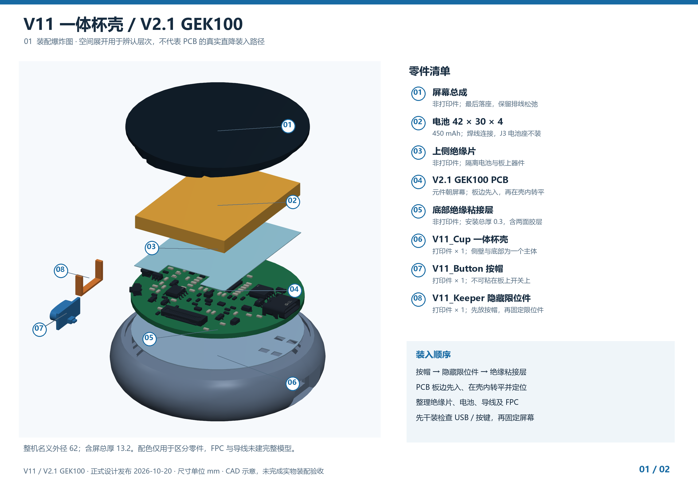
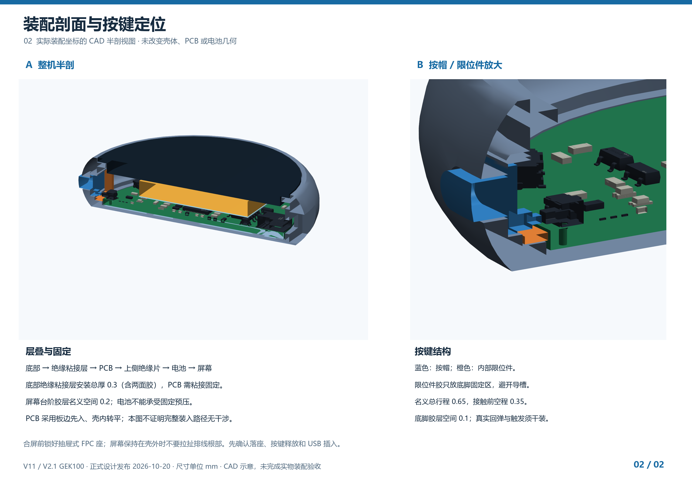

# V11 / V2.1 GEK100 装配说明

配套 [V11 正式外壳](README.md)与 [V2.1 PCB](../../../releases/V2_1_GEK100_20261020/README.md)。[下载两页装配图](images/assembly-guide.pdf)，图中 01～08 与下表对应。

## 准备零件

| 图号 | 零件 | 数量 / 要求 |
| --- | --- | --- |
| 01 | ST77916 圆屏及触摸总成 | 1；沿原排线通道连接 |
| 02 | 电池 | 1；450 mAh、42×30×4 mm 为当前参考，核对实际极性、厚度及引线 |
| 03 | 电池与器件之间的绝缘片 | 1；非打印件，按参考轮廓确认覆盖 |
| 04 | V2.1 GEK100 PCB | 1；元件朝屏幕，J3 电池座不装，电池线直接焊接 |
| 05 | 底部绝缘粘接层 | 1；安装总厚 0.3 mm，含两面的胶，不可只放一张未粘接薄片 |
| 06 | V11_Cup | 打印 1 件，一体杯壳 |
| 07 | V11_Button | 打印 1 件，侧面按帽 |
| 08 | V11_Keeper | 打印 1 件，内部按帽限位件 |

## 装入顺序

1. **空壳装按帽。** 按帽从壳内向侧孔外推入，挡肩留在内部；按帽不能粘到 PCB 开关上。
2. **装隐藏限位件。** 从屏幕口放入 Keeper，向按键侧移入底脚定位凹位。胶只放在底脚固定区，不能流进导槽；先检查按帽能活动、限位件已落座。底脚胶层名义空间为 0.1 mm。
3. **准备 PCB 固定面。** 放置并对齐底部绝缘粘接层，核对焊脚窗口、Type-C、按帽推杆和板边位置。0.3 mm 是衬片与两面胶合计的安装厚度；实际焊锡凸出未测量，先干装检查，不靠强压落座。
4. **PCB 板边先入，再转平。** 沿用实际装配手法，将 PCB 近乎立起，板边先进入屏幕口，再在壳内转平落座；不是整板平放直降。屏幕与电池可先连接并放在壳外，排线保持自然松弛。先确认位置再完成 PCB 的底部粘接固定。
5. **整理绝缘、电池和连接。** 电池与板上器件之间放好绝缘片，收好电池导线；抽屉式 FPC 座在仍可操作时锁好，不在狭缝中硬撬。屏幕保持在壳外时，不把它当铰链反复掀起，不牵拉排线根部。
6. **干装检查后合屏。** 屏幕最后落座，台阶名义胶层空间为 0.2 mm。固定屏幕前先核对下面的检查项；屏幕不是 PCB 压板，电池不能承受固定预压。

爆炸图是零件层次说明，不是经过验证的装入轨迹。完整倾斜装入路径与连接排线的运动仍待实物确认；遇到阻力先退出检查，不硬压、折板或夹紧排线。

## 合屏前检查

- PCB、绝缘层和 Keeper 均正确落座；固定后 PCB 不应在壳内活动。
- USB 插头可完整插入，导线和电池不会被夹住。
- 按帽无静态预压、不卡滞、松手能释放；真实 1 秒开机、3 秒关机需在装配后验证。
- 按帽设计总行程约 0.65 mm、接触前空程约 0.35 mm；没有独立回位弹簧，不能用名义尺寸替代实际触发与回弹检查。
- 屏幕显示、触摸和 FPC 连接正常，边缘没有因固定造成的顶压。

## 模型与验证的范围

SolidWorks 包解压后保持 SLDASM 与全部八个 SLDPRT 在同一目录。PCB 参考件在装配中沿 Z 方向放置 +1.8 mm；其余模型已在装配坐标中。STEP 包中的完整装配已包含这些位置，不要再次叠加偏移。

PCB 图形参考未覆盖全部柔性排线、实物焊锡及真实连接器抽屉行程；电池参考包络不证明实物密封边、引线和膨胀空间。胶材和打印材料尚无本版实物强度结果，不指定原试装使用过的 502 为正式胶种。

正式配套发布沿用原几何；CAD 静态检查与当前发布核对见 [发布说明](README.md#发布与验证状态)，不代替打印和实物装配验收。
