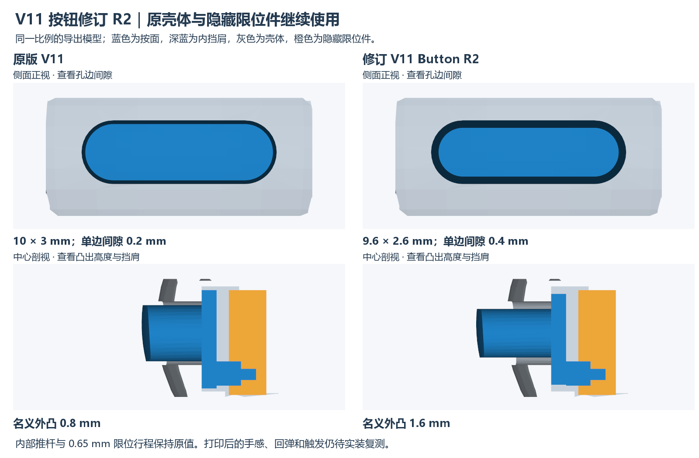

# CABadge V11 正式外壳 · 配套 V2.1 GEK100

2026-10-20 起，项目采用 **V11 一体杯壳作为 V2.1 GEK100 的正式配套外壳**。2026-10-28 修正按钮发布文件，当前使用 **V11_Button_R2**（2026-10-26 修订）；杯壳、隐藏限位件及其他参考零件沿用原模型。V6 保留为旧首板的历史版本。

配套板卡：[V2.1 GEK100 双格式工程](../../../pcb/current/README.md)，包括 KiCad 10 与嘉立创EDA专业版工程。对应 KiCad PCB SHA-256：`9d094d57cf92abfb1791aaf05bcdb3205478dee128614ef87b8f4fef2c3da4ea`，与 V11 几何检查记录一致。

## 下载与打印

| 文件 | 用途 |
| --- | --- |
| [V11_Cup.stl](print/V11_Cup.stl) | 一体杯壳，打印 1 件；侧壁与底部是一个主体 |
| [V11_Button_R2.stl](print/V11_Button_R2.stl) | R2 侧面按帽，打印 1 件；已替换误上传的旧按钮 |
| [V11_Keeper.stl](print/V11_Keeper.stl) | 壳内按帽限位件，打印 1 件 |
| [STEP 模型包](cad/CABadge_V11_V2_1-STEP.zip) | 含 R2 按钮的完整八部件装配 STEP，以及三个打印件各自的 STEP |
| [SolidWorks 模型包](cad/CABadge_V11_V2_1-SolidWorks.zip) | 已更新为 R2 按钮的原生 SLDASM 与全部 8 个配套 SLDPRT，解压后保持同目录 |
| [装配图 PDF](images/assembly-guide.pdf) | 已同步 R2 的两页 A3 横向图：爆炸图、整机半剖及按键限位细节 |
| [装配说明](ASSEMBLY.md) | 零件清单、装入顺序、固定方式与干装检查 |
| [SHA256SUMS.txt](SHA256SUMS.txt) | 发布文件校验值 |

三个 STL 的单位为 mm，切片保持 100% 比例。屏幕、电池、绝缘片和 PCB 不是打印件。V6 的拨片不适用；V11 是按帽配隐藏限位件的按键结构。

STEP 装配包含 PCB、屏幕和电池参考模型；SolidWorks 装配为固定位置参考，不是带驱动配合的运动装配。PCB 图形参考不包含完整柔性排线或实际焊锡，装配时以实物干装结果为准。

## 当前按钮 R2

R2 对应此前“间隙偏小、外露偏少”的修改；本次将已核验的 R2 同步到全部下载文件，没有重新设计杯壳或限位件。旧按钮不再作为当前打印文件提供。

| 尺寸 | 原按钮 | 当前 R2 |
| --- | --- | --- |
| 按面 | 10 × 3 mm | 9.6 × 2.6 mm |
| 按面单边名义间隙 | 0.2 mm | 0.4 mm |
| 曲面名义外凸 | 0.8 mm | 1.6 mm |

原孔保持 10.4 × 3.4 mm。内部推杆根部和接触端保持原位置，名义总行程 0.65 mm、接触前空程 0.35 mm；全行程末端最小名义外凸约 0.95 mm。

## 装配图

两图直接由配套 STEP 几何生成，配色用于区分零件。爆炸图沿轴向展开以显示层次，**PCB 实际采用板边先入、再在壳内转平的方式**，不能按图把整板平放直降。可编辑标注源：[爆炸图 SVG](images/assembly-exploded.svg)、[剖面图 SVG](images/assembly-details.svg)。

## 配套结构

- 杯壳名义外径 62 mm，含屏总厚 13.2 mm；侧面按帽突出于杯壳。
- 杯壳取消旧上下壳接缝及三个 PCB 上限位，PCB 由底部绝缘粘接层固定；安装总厚 0.3 mm，包含两面胶层。
- 电池参考为用户确认的 450 mAh、42×30×4 mm，正负线直接焊接，J3 不装。电池上方为屏幕，下方绝缘片隔离板上器件；电池不能承受固定预压。
- 屏幕粘接台阶的名义胶层空间为 0.2 mm；隐藏限位件底脚名义胶层空间为 0.1 mm。胶材、打印公差及粘接强度需根据实物干装确认。
- USB 挡墙已按原圆弧壳面裁齐，底面恢复平整；不包含已撤回的 V10 遮光改型。

## 发布与验证状态

**发布状态是正式配套设计；这不改变尚未完成的实物验证记录。**

本次发布核对确认：R2 的 STL、STEP、SLDPRT 与原 R2 验证包的指纹一致；其余七个原生零件及七份 STEP 来源保持原文件，杯壳和限位件的 STL 也逐字节不变。R2 STL 水密、单实体，共 404 个三角面。SolidWorks 重新打开后八个部件完整解析、位置核对通过；STEP 完整装配回读为 573 个实体，两个 CAD 压缩包 CRC 通过。装配图使用同一组 R2 几何与既定装配坐标。

R2 状态为 **`BUTTON_CAD_PASS_PRINTED_FIT_PENDING`**。原修订的几何、行程及限位检查见 [R2 检查记录](verification/button-r2.json)和[网格检查](verification/button-r2-mesh.json)，本次原生装配与 STEP 打包核对见 [R2 发布包核对](verification/button-r2-packaging.json)。这些检查不证明打印后的摩擦、回弹、倾斜和真实开关触发；按帽没有独立回位弹簧，仍需实际打印干装。

原有刚体静态检查通过；完整的倾斜装入路径、真实 FPC/抽屉行程、打印公差、胶粘强度、按键回弹及实物整机装配仍待确认。`source-*.json` 是 2026-10-20 基线历史报告，其中旧按钮的结果不作为 R2 结果；原报告的 `passed=false` 和 `RIGID_CHECKS_PASS_INSERTION_PENDING` 保留在 [原始检查记录](verification/source-verification.json)。当前发布摘要见 [publication-summary.json](verification/publication-summary.json)。

实物反馈继续记录在项目的 [首板测试记录](../../../../首板测试记录.md)。旧模型和历史失败记录保留，不将正式发布日期当作新实板测试日期。

本项目原创外壳设计采用仓库 [MIT License](../../../../LICENSE)；PCB 参考中的第三方器件模型与资料保留各自权利归属。
