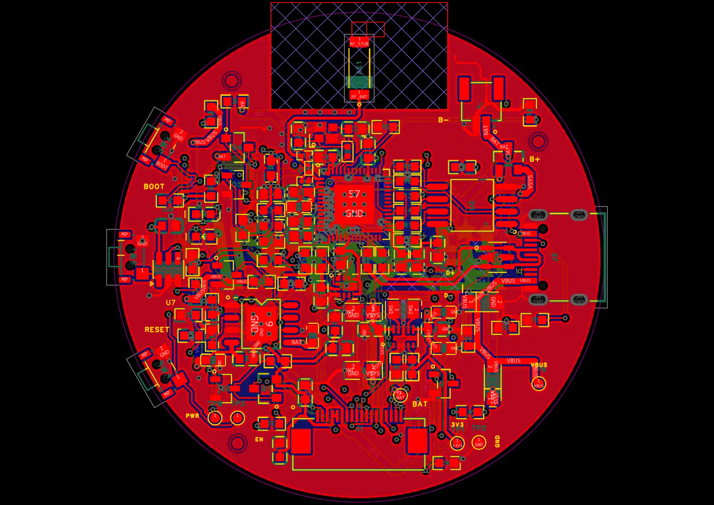
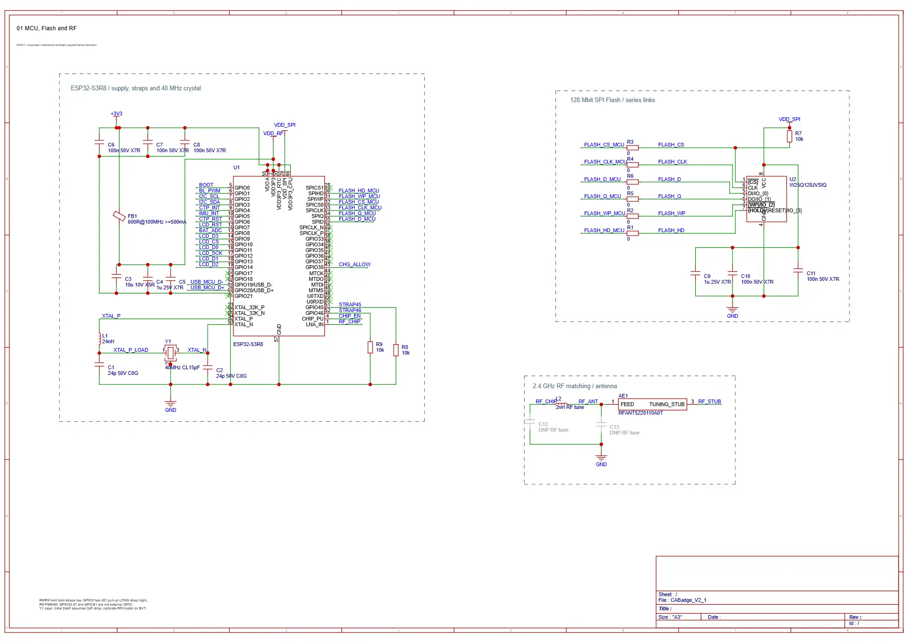

# CABadge 星火计划 · 嘉立创EDA原生重画工程

这是 **2026-10-27** 从“CABadge-基于 ESP32-S3 的电子吧唧-星火计划”工程保存并导出的最新版本。五张原理图直接复用原工程；PCB 在新工程中原生重画，按确认的布局恢复原版走线和正面丝印，底部使用星火计划 Logo。

**[下载完整原生工程 CABadge_StarPlan_EasyEDA_Native_20261027.epro2](CABadge_StarPlan_EasyEDA_Native_20261027.epro2)**

## 工程内容

| 内容 | 本次归档 |
| --- | --- |
| 原理图 | CABadge_V2_1、Controls_Test、Display_Sensor、Power_Button、USB_Power，共 5 页 |
| PCB | PCB1，直径 50 mm，四层 |
| 器件 / 走线 / 过孔 | 107 / 1,858 / 237 |
| 库和图像 | 原生工程内嵌的符号、封装、器件和丝印图像 |
| 保存时间 | 2026-10-27 15:23（北京时间），导出前六个文档均保存成功 |

在嘉立创EDA专业版 V4 的“导入专业版”入口选择上述 `.epro2`，建议导入为独立工程并保留内嵌库。本包由桌面专业版 4.1.78 导出；本次未做重新导入测试。

## 当前状态

- PCB 保留已完成的原版连线恢复、正面丝印和底部星火计划 Logo。本次只保存、导出和上传。
- J1 为 **AFC07-S18ECC-00 / C2840708**，按用户决定保留现有封装，包括两侧固定焊盘。
- U3 保持 **SC7A20TR / C5126709**。
- 元器件库及 BOM 核对已按用户要求停止，尚未全部完成；U7 商城料号仍待明确。本次归档不生成新的采购清单。

## 归档验证

原生压缩包 CRC 通过，已确认包含五张原理图和一个 PCB。与已保存的走线恢复版本比较，PCB 非器件记录中的走线、过孔、铺铜及丝印记录不变；器件位置不变，差异为 BOM 属性和等价角度的序列化。

最近保留的 EDA DRC 记录为 **2026-10-27 14:38:37（北京时间），0 项违规**；本次上传未重跑 DRC。归档完整性与已有 CAD 检查不代表新板制造、装配或实物功能验收。

校验摘要见 [verification/summary.json](verification/summary.json)，逐文件清单见 [MANIFEST.json](MANIFEST.json) 和 [SHA256SUMS.txt](SHA256SUMS.txt)。工程文件 SHA-256：

```text
9c335971ff7f0c77a8030949b27930cb43197a29638a4cce736567127c67a8a5
```

## 工程内预览

以下图片直接提取自本次导出的原生工程；PCB 图片为工程内的图层叠加预览。





[2026-10-20 KiCad 与转换版 EDA 快照](../V2_1_GEK100_20261020/README.md)保留历史含义；后续修改以本目录的原生重画工程为入口。
